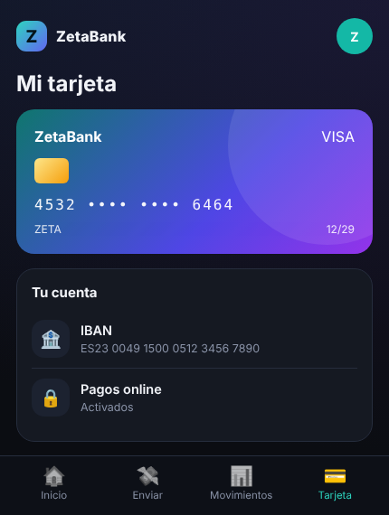

# ZETA LAB — ZetaBank 🏦
### Laboratorio de seguridad web

Bienvenido al primer laboratorio de Zeta. En esta práctica entrarás en **ZetaBank**, una banca online ficticia que hemos preparado para que aprendas a mirar una aplicación web como lo hace un pentester: observando qué recibe el navegador, qué envía y qué decide realmente el servidor.

No hace falta experiencia previa: la idea es aprender probando y entender qué ocurre detrás de una web.

> ⚠️ **Importante:** este entorno se ha creado únicamente con fines educativos. Se ejecuta en tu propio equipo y contiene comportamientos inseguros de forma intencionada. No lo publiques en Internet ni lo utilices contra sistemas ajenos.

<p align="center">
  
</p>

## 🎯 Escenario
### ¿Y si pudieras hacerte millonario entrando en tu propio banco?

Eres cliente de **ZetaBank**, tienes una cuenta bancaria, acceso a la banca online y unas credenciales que acabas de recibir.

Todo parece normal... pero ¿alguna vez te has preguntado cuánto podrías descubrir si investigaras a fondo tu propio banco?

Quizás haya algo más detrás de esa pantalla de inicio de sesión. Quizás tu cuenta esconda algo que nadie esperaba que encontraras.

**Tus credenciales:**
- Usuario: `zeta`
- Contraseña: `Zeta123`

**Tu misión:** conseguir la flag, que tiene el formato `ZETA{...}`.

## 📚 ¿Qué vamos a practicar?
- Navegar una aplicación web e identificar qué acciones permite.
- Observar qué recibe y qué envía el navegador con las herramientas de desarrollador.
- Pensar como un atacante: preguntarte qué más hay detrás de lo que se ve.
- Seguir una metodología básica de pentesting: reconocer, investigar, probar y concluir.

No se incluyen soluciones en este README: parte del aprendizaje está en investigar el laboratorio por tu cuenta.

## 🧰 Requisitos
- Un navegador web y una terminal.
- **Python 3** (viene instalado en Kali, Ubuntu, Debian y macOS). Comprueba con `python3 --version`.
- Git, o descargar el ZIP desde GitHub.

## 🚀 Instalación y puesta en marcha

### ⚡ Arranque rápido (Linux / macOS)
Abre tu terminal, **copia y pega esto** y ya está:

```bash
git clone https://github.com/zetachess/zeta-labs---zeta-bank.git
cd zeta-labs---zeta-bank
python3 app/zetabank.py
```

Deja esa terminal abierta y entra desde el navegador en:

**http://127.0.0.1:8000**

Si todo ha ido bien, verás la pantalla de acceso de ZetaBank. Cuando termines, pulsa `Ctrl+C` en la terminal para pararlo.

> ¿No usas Git? En este repositorio pulsa **Code → Download ZIP**, descomprime y ejecuta `python3 app/zetabank.py` desde esa carpeta.
> ¿Windows? Instala Python desde python.org (marca *Add Python to PATH*) y ejecuta `python app\zetabank.py`.

### 🐳 Alternativa: con Docker
Si prefieres tenerlo aislado en un contenedor, desde la carpeta del proyecto:

```bash
docker compose up -d --build
```
Y para pararlo: `docker compose down`.

> En Linux, si ves `permission denied ... docker.sock`, usa `sudo docker compose up -d --build`, o añade tu usuario al grupo `docker` con `sudo usermod -aG docker $USER` y vuelve a iniciar sesión.

## 🔎 Primeros pasos
1. Entra con las credenciales de arriba y recorre todas las pestañas de la app.
2. Abre las herramientas de desarrollador del navegador (`F12`) y observa la pestaña **Red / Network**.
3. Fíjate en las peticiones que se producen al enviar un formulario.
4. Prueba a repetir peticiones sencillas desde la terminal con cURL.

> 💡 **Pista:** una web es mucho más que lo que se ve en pantalla. Fíjate también en lo que el servidor te entrega.

## 💻 Un ejemplo con cURL
Para ver la respuesta HTTP de la pantalla de acceso:

```bash
curl -i http://127.0.0.1:8000/login
```
La opción `-i` muestra también las cabeceras de la respuesta. Compara lo que devuelve cURL con lo que ves en el navegador.

## 🛠️ Problemas frecuentes
- **Docker: `permission denied`:** en Linux usa `sudo` o añade tu usuario al grupo `docker` (ver arriba).
- **Docker no arranca:** comprueba que Docker Desktop está abierto o que el servicio Docker está en ejecución.
- **No carga 127.0.0.1:8000:** comprueba que el programa sigue en marcha. Con Docker: `docker compose ps`.
- **El puerto 8000 ya está ocupado (Python):** ejecuta `PORT=8001 python3 app/zetabank.py` y abre `http://127.0.0.1:8001`.
- **El puerto 8000 ya está ocupado (Docker):** en `compose.yaml`, cambia `127.0.0.1:8000:8000` por `127.0.0.1:8001:8000` y abre `http://127.0.0.1:8001`.
- **Quieres ver los errores del contenedor:** ejecuta `docker compose logs`.
- **Quieres reiniciar el estado del banco:** para el programa y vuelve a arrancarlo (con Docker, `docker compose restart`). El banco vuelve a su estado inicial.

## 🏴‍☠️ Sobre Zeta
Zeta es una iniciativa para aprender ciberseguridad practicando, con laboratorios y write-ups en español. Lo importante es entender por qué haces cada cosa, no copiar comandos sin más.

Más laboratorios en: https://zetacibercurity.vercel.app

Ponte a probar, rompe cosas (dentro de la máquina, claro 😎) y aprende.

## 📄 Licencia
El código de este repositorio se distribuye bajo la licencia MIT. Consulta el archivo [LICENSE](LICENSE) para conocer sus condiciones.
